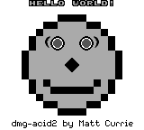
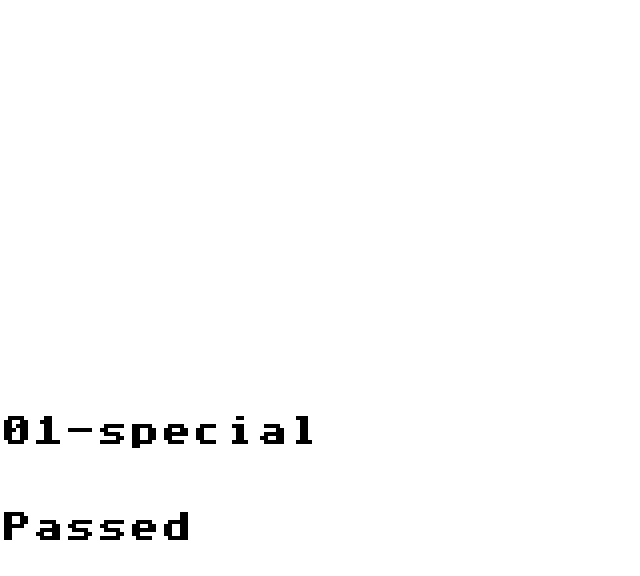
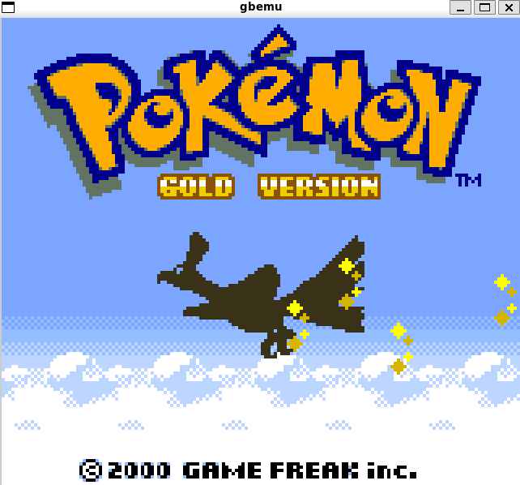
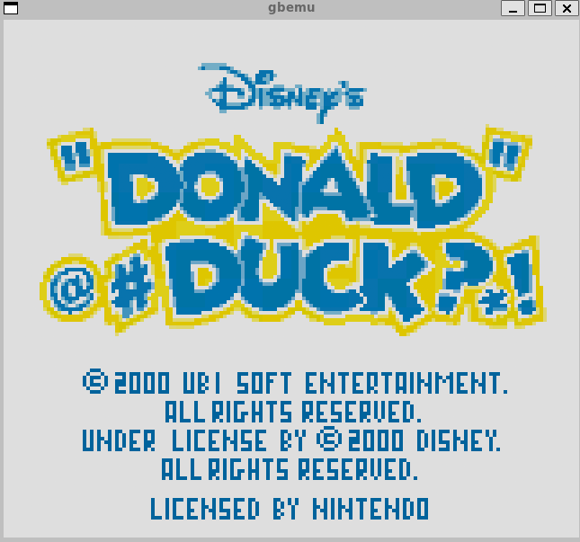

<div align="center">

# Chase Boy Emulator | Game Boy Color Emulator (GBC)


**A Game Boy emulator written from scratch in C**, DMG first, with Game Boy Color support in progress.

Written by **ChaseWright12**.


</div>

---

> ⚠️ **Work in progress.** This is a learning project under active development. The CPU, timer, and DMG video already pass their current test ROMs. Joypad input is supported through the keyboard and SDL2 game controllers, including the **PS4 DualShock 4 and Microsoft Driver Conrollers over USB**. Cartridge support now includes **MBC1, MBC3, and MBC5** with ROM/RAM bank switching. Game Boy Color video, audio, save persistence, and further hardware accuracy are still in progress. Compatibility with commercial games is not guaranteed yet. Things will change often (and break). Feedback and suggestions are very welcome.

## 📖 About

**Chase Boy Emulator** is a hands-on study project to understand how the Game Boy and the Game Boy Color work under the hood by rebuilding each piece of their hardware in software. I'm building it to learn C, low-level programming, and computer architecture. The goal is to run real games with video, controls, and, last of all, sound.

Because the main goal is learning, the code favors **clarity over performance**: simple structures, no global variables, and each component's state kept in a `struct` passed by pointer.

## 🖼️ Screenshot

The emulator rendering [dmg-acid2](https://github.com/mattcurrie/dmg-acid2), a test ROM that exercises the background, window, and sprites. The output matches the official reference image **pixel for pixel**.

<div align="center">



</div>

The emulator successfully passes the DMG-ACID2 test. The "01-special Passed" message confirms that the tested rendering behavior meets the ROM's expected result.

<div align="center">



</div>

The emulator rendering a gameplay for "Pokemon Gold Version (2000)" as DMG (Game Boy Color).


<div align="center">



The emulator running **Donald Duck - Goin' Quackers (Game Boy Color)**, demonstrating the current progress of CGB graphics rendering, color palettes, tile attributes, and VRAM DMA support.

<div align="center">
  
</div>

</div>


## ✨ Current status

| Component | Status | Notes |
|---|:---:|---|
| ROM loading and header parsing | ✅ | Title, Game Boy / Color mode, cartridge type, and ROM size |
| Memory bus | ✅ | ROM, VRAM, cartridge RAM, WRAM, Echo RAM, OAM, I/O, HRAM, `IE`, and OAM DMA |
| CPU (Sharp LR35902) | ✅ | Full instruction set, `0xCB` prefix, interrupts, `HALT`, and delayed `EI` |
| Timer | ✅ | `DIV`, `TIMA`, `TMA`, and `TAC`, including falling-edge behavior |
| Blargg `cpu_instrs` | ✅ | The 11 individual ROMs pass, in both DMG and Color mode |
| PPU (video, DMG) | ✅ | Background, window, sprites, STAT/VBlank interrupts. Passes `dmg-acid2` |
| Screenshots and SDL2 window | ✅ | PNG output works anywhere; the window is optional (`make SDL=1`) |
| Joypad input | ✅ | Keyboard and SDL2 game controllers; PS4 DualShock 4 tested over USB |
| Cartridge controllers | ✅ | MBC1, MBC3, and MBC5 ROM/RAM bank switching |
| Game Boy Color | ✅ | Banked VRAM/WRAM and speed switch implemented; color palettes, tile attributes, and other CGB features implemented |
| APU (audio) | 🚧 | The 4 sound channels |
| Saves (battery-backed RAM) | ⬜ | Persistent cartridge RAM and save files not implemented yet |

## 🛠️ Requirements

- A Linux system (or **WSL** on Windows)
- `gcc` (or `clang`) and `make`
- `libsdl2-dev` for the graphical window and game controller support

On Ubuntu/WSL:

```bash
sudo apt update
sudo apt install build-essential git
sudo apt install libsdl2-dev
```

## 🚀 Building and running

```bash
# 1. Clone the repository
git clone https://github.com/chasewright12/gbemu.git
cd gbemu

# 2. Build
make           # No window (headless)
make SDL=1     # SDL2 window and game controller support

# 3. Run with a ROM
./gbemu path/to/rom.gb
```

To remove the generated executable:

```bash
make clean
```

### Command-line options

| Option | What it does |
|---|---|
| `--frames N` | Runs exactly N frames and stops |
| `--png FILE` | Saves the last frame as a PNG (enlarged 4x), with no external library |
| `--headless` | Does not open a window, even in a build made with `SDL=1` |
| `--doctor` | Prints one log line per instruction in the [Gameboy Doctor](https://github.com/robert/gameboy-doctor) format |

Without `SDL=1`, the emulator always runs headless. With it, a window opens at 4x scale, paced at the real Game Boy speed (about 59.7 frames per second). Close it with `Esc`.

### 🎮 Controls

Interactive controls require an SDL-enabled build (`make SDL=1`). The keyboard controls remain available alongside SDL2 game controller input. **PS4 DualShock 4 support has been tested over USB.**

| Game Boy control | Keyboard | Controller |
|---|---|---|
| D-pad | Arrow keys | D-pad or left analog stick |
| A / B | `Z` / `X` | Mapped controller action buttons |
| Start | `Enter` | Start button |
| Select | `Backspace` | Back/Select button |
| Quit emulator | `Esc` | — |

> **WSL note:** If the window does not open, check that your WSL installation supports graphical applications through WSLg. USB controller access may require forwarding the device to WSL with [`usbipd-win`](https://github.com/dorssel/usbipd-win). The `--png` option works without a graphical window.

## 🧪 Testing

ROMs are **not** included in this repository. The tests below use public test ROMs.

### CPU and timer: Blargg's `cpu_instrs`

```bash
mkdir -p roms
git clone https://github.com/retrio/gb-test-roms.git roms/gb-test-roms

for rom in roms/gb-test-roms/cpu_instrs/individual/*.gb; do
  echo "== $(basename "$rom")"
  ./gbemu "$rom" 2>&1 >/dev/null | grep -E "Passed|Failed"
done
```

All 11 individual ROMs should print `Passed`. The complete `cpu_instrs.gb` also exercises cartridge banking, so it is useful for checking MBC1 support.

### Video: `dmg-acid2`

```bash
mkdir -p roms
curl -L -o roms/dmg-acid2.gb https://github.com/mattcurrie/dmg-acid2/releases/download/v1.0/dmg-acid2.gb
./gbemu roms/dmg-acid2.gb --frames 60 --png acid.png
```

Open `acid.png` and compare it with the [reference image](https://github.com/mattcurrie/dmg-acid2/blob/master/img/reference-dmg.png). They should be identical.

### Automated Testing Infrastructure

A Python-based testing environment has been introduced using pytest and ctypes, allowing automated testing of the emulator's C components.

Current test coverage inclues:
- **PPU FIFO**: Initialization, capacity, overflow, underflow, ordering, wraparound, metadata preservation, and mixed operations.
- **PPU Fetcher**: Initialization, state transitions, tile fetching, bitplane decoding, CGB attributtes, tile flipping, signed addressing, Window map selection, and FIFO stalling.

- **PPU Pipeline**: Dedicated test suite.
- **PPU Rendering**: Dedicated test suite.
- **Palette RAM**: Register behavior and palette memory tests.

The test infrastructure compiles the relevant C sources into a temporary shared library, allowing Python tests to interact directly with the emulator's native implementation.
- **GDMA/HDMA**: Register behavior, 16-byte block transfers, VRAM bank selection, transfer completion, and cancellation.
- **HDMA and PPU integration**: Automatic transfers during visible HBlank periods and transfer restrictions during VBlank.
- **CPU Stall**: CPU execution suspension, program counter preservation, cycle accounting, and execution resumption.
- **Double-speed DMA timing**: CPU Stall duration validation in both normal and double-speed modes.

### CGB VRAM DMA Tests

The DMA test suite uses Python and GCC to compile and execute native C tests against the emulator's implementation.

```bash
python3 tests/test_hdma.py
python3 tests/test_hdma_ppu.py
```

Current test results:

- [x] GDMA, VRAM bank and stall
- [x] HBlank blocks and completion
- [x] Cancellation between blocks
- [x] One block per visible HBlank
- [x] No HBlank transfer during VBlank
- [x] Normal-speed stall
- [x] Double-speed stall

**Test status:** 7/7 automated DMA tests passing.

### Development Environment
| Language | Build system | Graphics | Testing | Development environment
|---|---|---|---|---|
| C11. | GNU Make. | SDL2. | Python3, pytest, and ctypes. | Ubuntu on WSL2.

**Development philosophy**: Building the emulator from scratch, prioritizing hardware accuracy, modular architecture, memory safety, and incremental testing while expanding DMG and CGB compatibility.

---

### Cartridge controllers: MBC1, MBC3, and MBC5

Use homebrew and public test ROMs to verify bank switching and cartridge behavior. The ROM header's cartridge type byte identifies the controller:

| Header type | Controller |
|---|---|
| `0x01`–`0x03` | MBC1 |
| `0x0F`–`0x13` | MBC3 |
| `0x19`–`0x1E` | MBC5 |

For example, run a ROM with:

```bash
./gbemu roms/game.gb
```

Check the printed cartridge type and test ROM behavior. MBC3 RTC ticking/latching details, battery-backed save persistence, and some controller-specific hardware behavior may still need further implementation and testing.

## Game Boy Color (GBC) Improvements
- **Banked VRAM**: Support for two 8 KB VRAM banks, select through the VBK register (0xFF4F).
- **BANKED WRAM**: Support for eight 4 KB WRAM banks, controlled through SVBK (0xFF70).
- **CGB Palette RAM**: Implementation and correction of Background and Object Palette RAM.
- **Color palette rendering**: RGB555-to-RGBA color conversion and improved CGB palette handlibg.
- **Background palettes**: Support for eight sprite palettes, each containing four colors.
- **KEY1 speed switching**: CGB double-speed mode support.
- **OPRI register**: CGB object priority control.
- **CGB VRAM DMA Controller**: Dedicated DMA module with support for General Purpose DMA (GDMA) and HBlank DMA (HDMA).
- **HDMA Registers**: Implementation of the FF51-FF55 memory-mapped registers.
- **GDMA Transfers**: Continuous multi-block transfers into the selected VRAM bank.
- **HBlank DMA Transfers**: Automatic 16-byte block transfers during visible HBlank periods.
- **HDMA Cancellation**: Support for terminating active HBlank DMA transfers between blocks.
- **CPU Stall**: CPU instruction execution is suspended during DMA transfers while the PPU and timer continue advancing.
- **DMA Cycle Accounting**: Basic timing model using 32 PPU dots per block, equivalent to 32 CPU T-cycles in normal-speed mode and 64 in double-speed mode.
- **DMA and PPU Synchronization**: Integration with PPU mode transitions and the main emulator execution loop.
- **Automated DMA Validation**: Seven passing unit and integration tests covering DMA behavior and CPU suspension.

## 🗂️ Project structure

```text
.
├── Makefile
├── README.md
├── docs
│   └── images
├── src
│   ├── cart.c
│   ├── cart.h
│   ├── cartridge
│   │   ├── cartridge.c
│   │   ├── cartridge.h
│   │   ├── mbc1.c
│   │   ├── mbc1.h
│   │   ├── mbc3.c
│   │   ├── mbc3.h
│   │   ├── mbc5.c
│   │   └── mbc5.h
│   ├── cpu.c
│   ├── cpu.h
│   ├── dma
│   │   ├── hdma.c
│   │   └── hdma.h
│   ├── input.c
│   ├── input.h
│   ├── joypad.c
│   ├── joypad.h
│   ├── main.c
│   ├── mem.c
│   ├── mem.h
│   ├── png.c
│   ├── png.h
│   ├── ppu
│   │   ├── fetcher.c
│   │   ├── fetcher.h
│   │   ├── fifo.c
│   │   ├── fifo.h
│   │   ├── ppu.c
│   │   └── ppu.h
│   ├── timer.c
│   └── timer.h
└── tests
    ├── conftest.py
    ├── make_joytest.py
    ├── ppu_test_utils.py
    ├── test_dualshock.py
    ├── test_hdma.py
    ├── test_hdma_ppu.py
    ├── test_input.py
    ├── test_palette_ram.py
    ├── test_ppu_fetcher.py
    ├── test_ppu_fifo.py
    ├── test_ppu_pipeline.py
    └── test_ppu_rendering.py
```

## 🧠 How it works

The emulator operates through a centralized execution loop that coordinates the CPU, memory bus, timer, PPU, and DMA controller.

During normal execution, the CPU executes an instruction and reports the number of elapsed cycles. During DMA transfers, CPU instruction execution is temporarily suspended while the remaining hardware components continue advancing.

The execution loop also accounts for CGB double-speed mode, maintaining the PPU's dot frequency independently of the CPU clock frequency.

### CGB VRAM DMA (GDMA/HDMA)

The Game Boy Color introduces a dedicated VRAM DMA controller that allows data transfers into video memory without requiring the CPU to copy each byte individually.

The DMA controller is implemented as a separate hardware module in `src/dma/`, integrated with the memory bus, PPU, and main execution loop.

| Register | Address | Description |
|---|---|---|
| HDMA1 | `0xFF51` | Source address high byte |
| HDMA2 | `0xFF52` | Source address low byte |
| HDMA3 | `0xFF53` | Destination address high byte |
| HDMA4 | `0xFF54` | Destination address low byte |
| HDMA5 | `0xFF55` | Transfer length, mode, and status |

Two transfer modes are currently supported:

- **GDMA (General Purpose DMA):** Transfers all requested blocks consecutively.
- **HDMA (HBlank DMA):** Transfers one 16-byte block when the PPU enters HBlank on a visible scanline.

During DMA stalls, the CPU stops executing instructions while the timer and PPU continue advancing.

**Current limitations:** Data copying is currently performed instantaneously with subsequent CPU stall accounting. Progressive DMA transfers, precise bus timing, and full hardware accuracy remain under development.

### Memory bus

The Game Boy CPU sees a single 64 KB address space, but each range of addresses is a different piece of hardware. The memory bus (`mem_read` / `mem_write`) translates each address to the right region:

| Range | Region |
|---|---|
| `0x0000`–`0x7FFF` | Cartridge ROM |
| `0x8000`–`0x9FFF` | VRAM (two banks on Color) |
| `0xA000`–`0xBFFF` | Cartridge RAM / RTC registers (depending on controller) |
| `0xC000`–`0xDFFF` | WRAM (eight banks on Color) |
| `0xE000`–`0xFDFF` | Echo RAM (mirror of WRAM) |
| `0xFE00`–`0xFE9F` | OAM (sprites) |
| `0xFF00`–`0xFF7F` | I/O registers |
| `0xFF80`–`0xFFFE` | HRAM |
| `0xFFFF` | Interrupt enable register |

### Cartridge and memory bank controllers

Cartridge access is handled through a separate cartridge interface in `src/cartridge/`. The interface identifies the controller from the ROM header and dispatches reads and writes to the appropriate implementation.

- **MBC1:** ROM bank selection and switchable external RAM banks.
- **MBC3:** ROM bank selection, RAM bank selection, and RTC register selection/latching support.
- **MBC5:** 9-bit ROM bank selection and switchable RAM banks, with rumble-cartridge type recognition.

The cartridge controller maps the selected ROM or RAM bank into the CPU's address space. Battery-backed RAM persistence and complete RTC behavior are separate features and are not yet considered complete.

### CPU

The CPU uses the registers `A`, `F`, `B`, `C`, `D`, `E`, `H`, `L`, plus `SP` and `PC`. The `F` register holds the flags:

| Bit | Flag | Meaning |
|:---:|---|---|
| 7 | `Z` | Zero |
| 6 | `N` | Subtraction |
| 5 | `H` | Half-carry |
| 4 | `C` | Carry |

`cpu_step` first services any pending interrupt, then fetches an opcode, decodes it, executes it, and returns the cycles spent. Most opcodes are decoded from their bit patterns instead of one `case` each, which is why the whole instruction set fits in about 600 lines.

### Timer

`DIV` is the high byte of a 16-bit counter that increments every cycle. `TIMA` increments when a selected bit of that counter falls from 1 to 0, and the `TAC` register chooses which bit (four frequencies, from 4096 Hz to 262144 Hz). When `TIMA` overflows it reloads from `TMA` and requests an interrupt. Writing to `DIV` or `TAC` can also make `TIMA` tick, as on the real hardware.

### PPU

Each line takes 456 dots and goes through three modes (OAM scan, drawing, and HBlank), and a frame is 154 lines (144 visible plus 10 of VBlank), or 70224 dots. At the end of the drawing mode each line is rendered in three layers: background, window, and sprites (up to 10 per line, with the DMG priority rules). The PPU also raises the VBlank interrupt and the STAT interrupts (HBlank, VBlank, OAM, and `LYC=LY`).

Known simplifications: mode 3 always lasts 172 dots, and the CPU can access VRAM and OAM at any time.

The PPU development has been expanded with dedicated FIFO and Fetcher components, establishing the foundation for a more accurate pixel-fetchin pipeline.

- **PPU FIFO**: Implementation of a 16-pixel circular FIFO buffer.
- **Pixel metadata**: Each FIFO entry stores color ID, palette, priority, VRAM bank, object identification, background priority, and OAM index.
- **FIFO operations**: Initialization, clearing, push, pop, peak, overflow protection, and circular buffer management.
- **Pixel Fetcher**: Dedicated state machine with tile fetching, low-byte fetching, high-byte fetching, and pixel pushing stages.
- **Two-dot fetch stages**: Each fetching stage advances according to PPU dot timing.
- **Tile Map Fetching**: Background and Window tile map selection through LCDC registers.
- **Tile Data Addressing**: Support for both signed and unsigned tile addressing modes.
- **CGB Tile Attributes**: Palette selection, VRAM bank selection, horizontal and vertical flapping, and background priority.
- **Pixel Decoding**: Conversion of two bitplanes into eight individual color IDs.
- **FIFO Push Stalling**: Fetcher waits when the background FIFO contains more than eight pixels.

## 🗺️ Roadmap

- [x] Load the ROM and read its header
- [x] Memory bus
- [x] CPU structure and first opcodes
- [x] Implement all opcodes (including the `0xCB` prefix)
- [x] Pass Blargg's `cpu_instrs` tests (the 11 individual ROMs)
- [x] Timer and interrupts
- [x] PPU for the DMG: background, window, and sprites (`dmg-acid2`)
- [x] PNG screenshots and an optional SDL2 window
- [x] Game Boy Color groundwork: VRAM/WRAM banks and speed switch
- [x] Joypad input via keyboard and SDL2 game controllers (PS4 DualShock 4 tested over USB)
- [x] MBC1, MBC3, and MBC5 cartridge support (initial bank switching implementation)
- [x] Run commercial games reliably, including Tetris
- [x] Accurate cycle counting (`instr_timing`)
- [x] Game Boy Color video: palettes, tile attributes, and HDMA (`cgb-acid2`)
- [ ] Audio (APU)
- [ ] Battery-backed RAM persistence and save files
- [ ] Complete MBC3 RTC behavior and broader cartridge compatibility

## 🤝 Contributing

Since this is a learning project, I'm especially happy to receive:

- Explanations of things I got wrong or implemented in a roundabout way
- Pointers to good resources about the Game Boy hardware
- Bug reports and suggestions

Feel free to open an issue or a pull request. Please keep in mind that I'm doing most of the implementation myself on purpose, so I may prefer to discuss a fix before merging a large change.

## ⚖️ Legal notice

This project is an emulator and **does not include any ROMs or Nintendo code**. Emulating is legal, but distributing commercial ROMs is not. Use only test ROMs, homebrew, or dumps of cartridges you own.

*Game Boy is a trademark of Nintendo. This project is not affiliated with or endorsed by Nintendo.*

## 📚 References

- [Pan Docs](https://gbdev.io/pandocs/): the main hardware reference
- [Opcode table](https://gbdev.io/gb-opcodes/optables/)
- [gb-test-roms](https://github.com/retrio/gb-test-roms): Blargg's test ROMs
- [dmg-acid2](https://github.com/mattcurrie/dmg-acid2): PPU test ROM
- [Gameboy Doctor](https://github.com/robert/gameboy-doctor): CPU log comparison tool
- [SameBoy](https://github.com/LIJI32/SameBoy) and [Gambatte](https://github.com/sinamas/gambatte): reference emulators

## 📄 License

Distributed under the MIT License. See the `LICENSE` file for more details.

---

<div align="center">

<a href="https://github.com/chasewright12">
  
</a>

### Lucas Marques

Brazilian student passionate about programming and computer science.  
I build software on the side and I'm learning how computers work by creating this emulator from scratch.

[](https://github.com/chasewright12)  
[](https://www.linkedin.com/in/lucasmarquesdev/)

**A Brazilian open-source project.**  
If you like the project or learned something from it, consider giving it a star!

</div>
